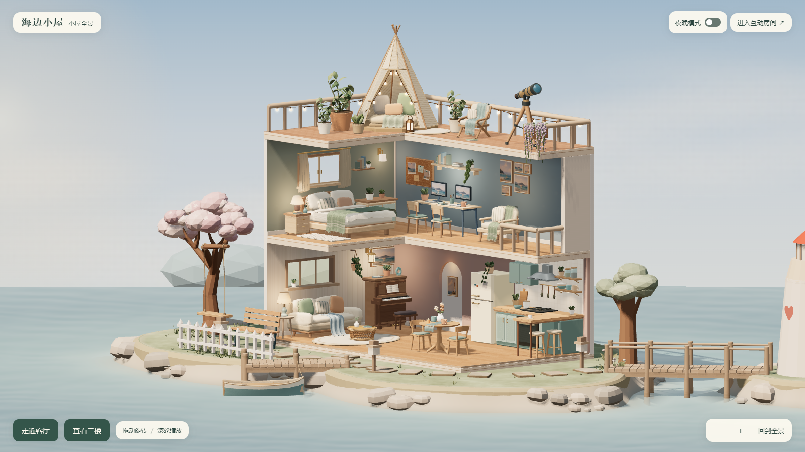
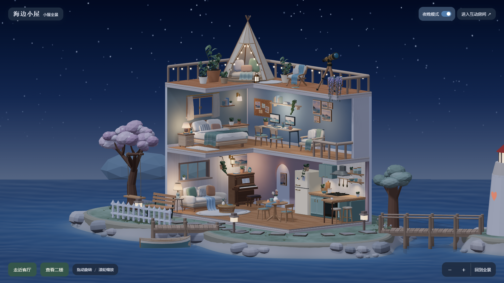
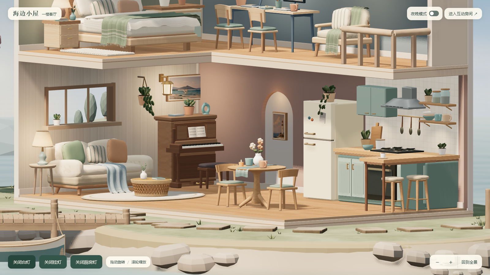
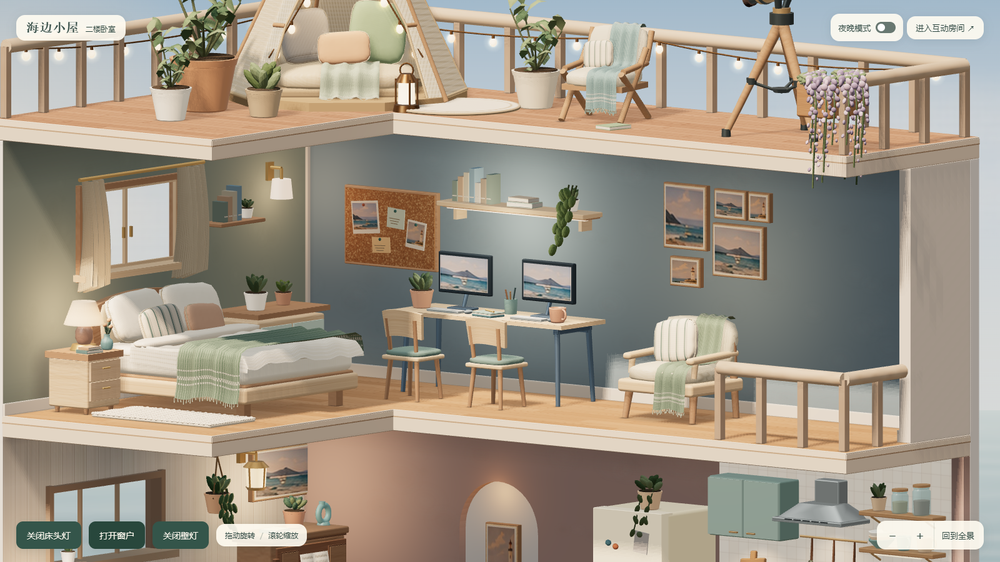
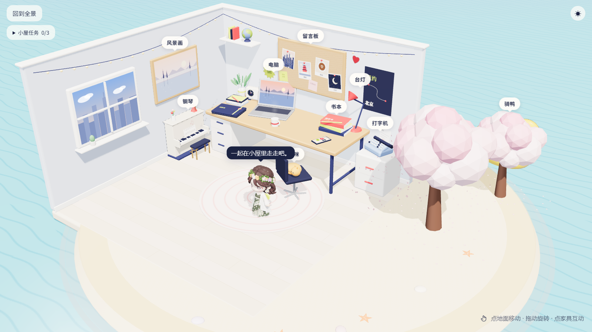

# 海边小屋 · Seaside Cottage

一座能在浏览器里旋转、走近、开灯拉窗帘的三层海边小屋。

原生 HTML / CSS / JavaScript + [Three.js](https://threejs.org/)，无构建步骤，不需要 `npm install`。

> A cozy three-story seaside cottage you can explore in the browser — built with Three.js, no build step, with a day/night mode and an interactive room.



## 截图

| 夜晚模式 | 一楼客厅与厨房 |
| :---: | :---: |
|  |  |
| **二楼卧室与书房** | **互动房间** |
|  |  |

## 功能

### 小屋全景（`index.html`）

- **三层剖面小屋**：一楼客厅与厨房（沙发、钢琴、饭桌、半岛吧台），二楼卧室与书房（双人床、双人电脑桌、软木留言板），屋顶露台（帆布帐篷、望远镜、串灯）。
- **海岛场景**：动态海面、樱花树秋千、花园围栏、木栈道、木船和灯塔。
- **昼夜切换**：天空、光照、海面颜色和环境反射平滑过渡，入夜后星空出现，庭院灯亮起。
- **走近看细节**：一键走近客厅或查看二楼，可单独开关台灯、挂灯、厨房灯、床头灯和壁灯，还能开关窗户。
- **操作方式**：拖动旋转，滚轮或双指缩放；键盘方向键旋转，`+` / `-` 缩放，`Home` 回到全景。

### 互动房间（`room.html`）

- 点地面让人物走过去，拖动旋转视角，点家具触发互动。
- 「小屋任务」：在钢琴上弹一段旋律、按一下台灯开关、摸摸椅子上的猫。
- 人物是 glTF 模型（`avatar.json`），用内置的轻量解析器加载；加载失败时会自动换成代码搭建的 Q 版人物。
- 可以骑小黄鸭出海，也支持昼夜切换。

## 快速开始

需要 [Node.js](https://nodejs.org/) 18 或更新版本（推荐 22 LTS）。

```bash
git clone git@github.com:BonanaByte/seaside-cottage.git
cd seaside-cottage

# 1. 首次运行：下载 Three.js 0.147.0 及扩展到 vendor/（需要联网）
node restore-dependencies.mjs

# 2. 启动本地服务
node serve.mjs
```

然后在浏览器打开 <http://127.0.0.1:4173/>。

- 依赖恢复后即可离线运行。
- 端口被占用时，可以用 `PORT` 环境变量换一个端口，例如 `PORT=8080 node serve.mjs`（Windows PowerShell 下为 `$env:PORT=8080; node serve.mjs`）。
- 两个脚本都只用 Node.js 内置模块。`restore-dependencies.mjs` 优先从 jsDelivr 下载，失败时自动改用 unpkg。

## 目录结构

```text
.
├── index.html               # 入口：海边小屋全景
├── room.html                # 独立的互动房间
├── serve.mjs                # 零依赖静态服务器（默认 4173 端口）
├── restore-dependencies.mjs # 下载 Three.js 到 vendor/
├── css/
│   ├── island.css           # 全景页样式
│   └── style.css            # 互动房间样式
├── js/
│   ├── island.js            # 全景主场景：渲染器、相机、房屋结构、材质、灯光、昼夜切换
│   ├── upstairs.js          # 二楼卧室与书房、窗户动画
│   ├── terrace.js           # 屋顶露台陈设
│   ├── soft-furnishings.js  # 地毯、靠枕、织物等软装
│   ├── landscape.js         # 岛屿地表起伏
│   ├── shore.js             # 海岸线、礁石、浅水
│   ├── outdoor-life.js      # 户外使用痕迹等细节
│   ├── coastal-palette.js   # 按材质类型统一调色
│   └── app.js               # 互动房间全部逻辑
├── assets/
│   ├── finishes/            # 橡木地板、甲板的颜色贴图与凹凸/粗糙度贴图
│   ├── coastal-prints.jpg   # 墙上挂画图集
│   └── local-textures.js    # 贴图的 base64 备份，仅供 file:// 方式打开时使用
├── avatar.json              # 人物 glTF 模型
├── avatar-embed.js          # 人物模型的 file:// 备用版本
└── docs/screenshots/        # README 截图
```

## 技术说明

- **Three.js 0.147.0**，使用经典的全局 `THREE` 脚本，没有打包工具。依赖的扩展有 `RoundedBoxGeometry`、`RoomEnvironment`、`GLTFLoader`。
- **材质**：以 `MeshStandardMaterial`（PBR）为主，窗户玻璃、小黄鸭和琴键用 `MeshPhysicalMaterial`。家具材质由 10 种预设质感（木头、布料、陶瓷、金属、皮革等）加颜色生成，并做了缓存。
- **纹理**：橡木地板和甲板使用真实贴图，凹凸和粗糙度共用一张图（R 通道存高度，G 通道存粗糙度）；木纹、织物、瓷砖、墙纸、草皮、石材等大多用 Canvas 实时绘制。
- **环境反射**：用 `RoomEnvironment` + `PMREMGenerator` 生成反射贴图，昼夜切换时同步调整强度。
- **渲染节奏**：页面切到后台时暂停渲染。系统开启「减少动态效果」时，会跳过过渡动画和海面动画，画面静止后不再重复渲染。

## 第三方依赖

- [Three.js](https://github.com/mrdoob/three.js) 0.147.0（MIT License）。没有提交到仓库，由 `restore-dependencies.mjs` 下载到 `vendor/`，同时下载它的许可证文件。
